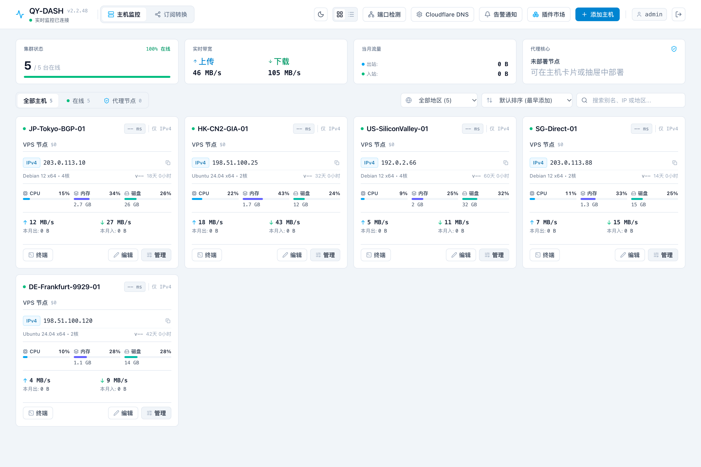
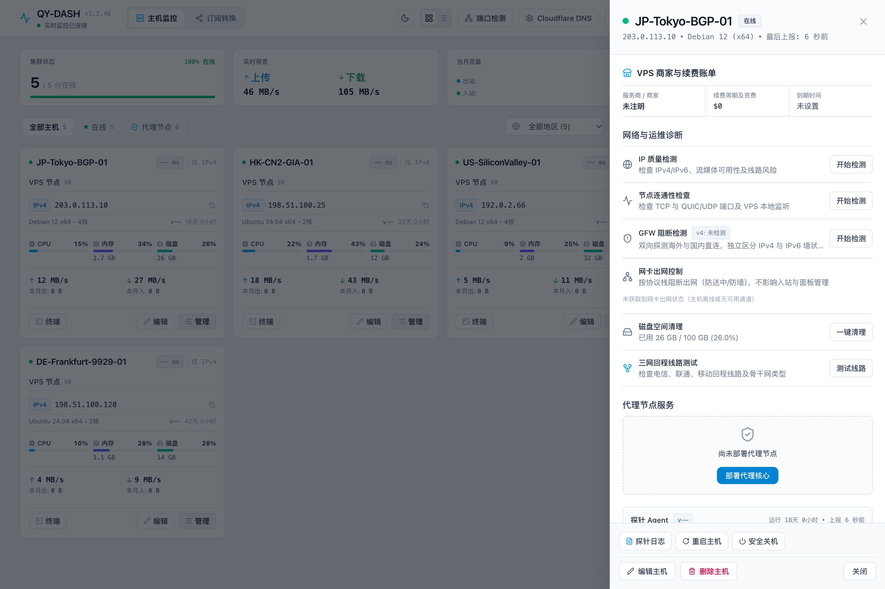
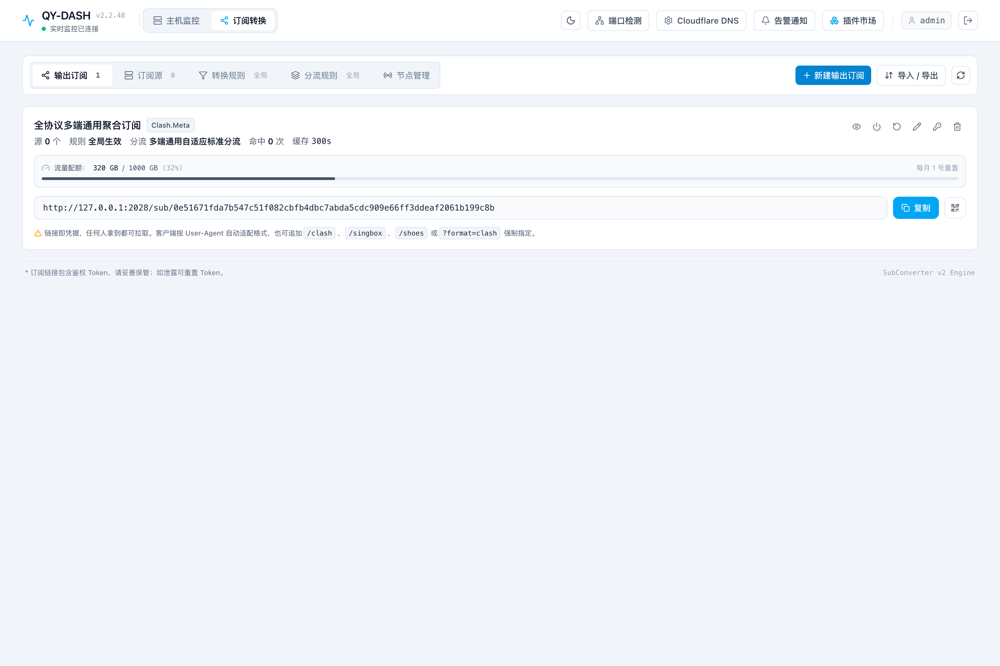
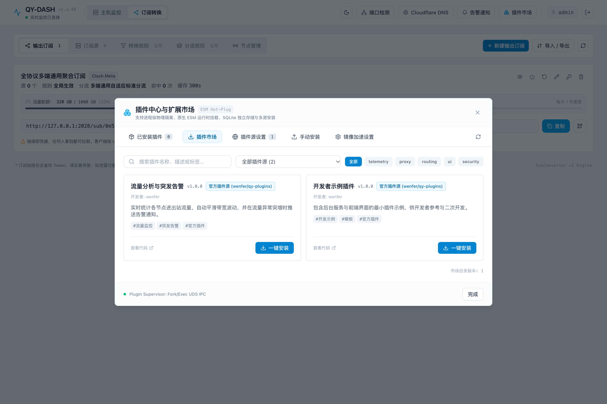

# QY-DASH

<p align="center">
  <strong>Linux 节点监控 · 代理核心托管 · 声明式订阅分流转换系统 · 微内核插件生态</strong>
</p>

<p align="center">
  <a href="docs/USER_GUIDE.md"></a>
  <a href="https://github.com/wenfer/qy-plugins/actions/workflows/ci.yml"></a>
  
  
  
  
  
</p>

---



本项目为 **QY-DASH** 公开文档中心与插件生态仓库，包含：
1. **QY-DASH 平台使用说明**：Docker 镜像极速部署、被控节点一键接入、环境参数参考与详细运维指南。
2. **官方插件市场索引 (`index.json`)**：为 QY-DASH 控制台「插件市场」提供插件元数据、版本包下载地址与 SHA-256 校验和。
3. **官方 Go Plugin SDK (`pkg/pluginsdk`)**：基于 Unix Domain Socket (UDS) 进程隔离通信的插件开发包，轻量零外部依赖。
4. **官方参考插件 (`plugins/`)**：包含流量分析突发告警 (`metrics-analyzer`) 与最小开发模板 (`template`)。
5. **官方文档中心 (`docs/`)**：涵盖主平台运维指南、双协议编排手册、插件清单规范与 SDK 开发教程。

> 💡 **镜像使用指引**：QY-DASH 官方多架构 Docker 镜像发布在 GitHub Container Registry：`ghcr.io/wenfer/qy-dash:latest`。

---

## 目录
- [QY-DASH 核心平台特性](#qy-dash-核心平台特性)
- [界面与功能展示](#界面与功能展示)
- [快速开始 (Docker 极速部署)](#快速开始-docker-极速部署)
- [被控 VPS 节点一键接入](#被控-vps-节点一键接入)
- [环境变量配置参考](#环境变量配置参考)
- [平台扩展文档导航](#平台扩展文档导航)
- [官方插件市场目录](#官方插件市场目录)
- [插件安装方式](#插件安装方式)
- [插件开发快速开始](#插件开发快速开始)
- [提交插件到官方市场](#提交插件到官方市场)
- [安全隔离机制](#安全隔离机制)

---

## QY-DASH 核心平台特性

QY-DASH 是一套面向 Linux 服务器的节点监控、双代理内核自动化编排与多端订阅分流转换系统。系统采用轻量 C/S 架构，服务端内嵌 SQLite 数据库与 React 19 单页应用，支持被控端主动长连接上报、Xray 与 Sing-box 核心协议共存管理、全网络栈适配、多维度网络质量检测与插件化扩展。

- **轻量 C/S 运行架构**  
  控制端 `qy-dash-core` 单容器/单二进制交付，内嵌 Web 管理界面与持久化数据库，开箱即用。被控端 `qy-dash-agent` 资源占用低（常驻内存 < 10MB），无需在服务端保存目标主机 SSH 凭据，通过双向长连接主动上报指标并执行受控运维指令。
- **Xray 与 Sing-box 双内核并行管理**  
  单台 VPS 支持同时托管运行 VLESS-Reality（免申请 TLS 证书）、Hysteria2（UDP 拥塞控制）与 TUIC 协议，端口分配与伪装域名自动校验，互不干扰。
- **全场景网络栈支持**  
  原生支持 IPv4 单栈、IPv4/IPv6 双栈、NAT 端口映射机型；针对纯 IPv6 VPS，可自动配置 NAT64 路由与 DNS64 解析，确保境外网络访问连通性。
- **多维度网络与资产诊断**  
  内置 Google 与 YouTube 定位检测、IP 风险画像识别、流媒体与主流 AI 服务可用性测试、三网回程链路分析以及 GFW 阻断状态侦测。
- **声明式订阅转换与客户端自适应**  
  聚合外部订阅与自建节点，提供可视化的策略组配置、节点清洗与规范重命名规则。依据客户端 `User-Agent` 动态分发对应格式（Clash / Sing-box / V2Ray 等）。
- **进程隔离插件体系**  
  基于 UDS IPC 与独立进程隔离模型构建，提供插件生命周期管理、官方插件市场以及第三方仓库接入能力，支持运行时热挂载与前端动态组件扩展。
- **多渠道故障与运维告警**  
  支持 Telegram Bot 与通用 Webhook（覆盖飞书、企业微信、Discord、Slack 等平台），实时推送节点上下线事件与主机续费预警，内置防抖策略避免网络瞬时抖动造成告警轰炸。

---

## 界面与功能展示

### 1. 主机监控与运维抽屉
控制台提供全局节点概览，支持查看各节点 CPU、内存、存储与实时网络吞吐。在侧边抽屉中可直接执行节点网络诊断、IP 质量检测与磁盘垃圾清理。


### 2. 订阅管理与分流配置
支持对多来源订阅进行聚合、过滤与重命名，并通过可视化界面编排策略组与路由规则，生成具备流量配额管控的单条通用订阅链接。


### 3. 插件中心与扩展市场
支持在线浏览与安装官方生态插件，提供进程级隔离保护，并允许用户添加第三方 Git 插件仓库。


---

## 快速开始 (Docker 极速部署)

### 方式 1: Docker Compose 部署 (推荐)

在服务器创建 `docker-compose.yml`（或直接使用本仓库提供的 [docker-compose.example.yml](docker-compose.example.yml)）：

```yaml
services:
  qy-dash:
    image: ghcr.io/wenfer/qy-dash:latest
    container_name: qy-dash
    restart: unless-stopped
    ports:
      - "2026:2026"
    environment:
      # Web 管理员账号与密码（首次部署请务必修改为强密码）
      - WEB_USER=admin
      - WEB_PASS=Your_Strong_Password_Here
      # SQLite 数据库持久化路径
      - DB_PATH=/data/qy-dash.db
      # 加密主密钥种子（可选；留空时将自动生成 master.key 保存在数据卷中）
      - SECRET=Your_Deterministic_Secret_Seed_32_Chars
    volumes:
      - ./data:/data
```

启动容器：
```bash
docker compose up -d
docker compose logs -f
```

启动完成后，使用浏览器访问 `http://<服务器IP>:2026` 即可进入管理控制台。

### 方式 2: Docker CLI 一键命令

```bash
mkdir -p data
docker run -d \
  --name qy-dash \
  --restart unless-stopped \
  -p 2026:2026 \
  -e WEB_USER=admin \
  -e WEB_PASS=Your_Strong_Password_Here \
  -e DB_PATH=/data/qy-dash.db \
  -v $(pwd)/data:/data \
  ghcr.io/wenfer/qy-dash:latest
```

---

## 被控 VPS 节点一键接入

在 Web 控制台点击 **「添加主机」**，复制为当前实例生成的一键接入命令，并在被控 Linux 服务器（Debian / Ubuntu / CentOS / Alpine，支持 x86_64 与 ARM64）上执行：

```bash
# 获取注册密钥：在控制台「添加主机」弹窗中复制
SECRET=<控制台展示的注册密钥>

# 标准 Linux (Debian / Ubuntu / CentOS / Rocky 等)
curl -fsSL http://<服务端地址>:2026/install.sh | sh -s -- \
  --server http://<服务端地址>:2026 --secret $SECRET --name "节点名称"

# Alpine Linux / 极简环境
wget -qO- http://<服务端地址>:2026/install.sh | sh -s -- \
  --server http://<服务端地址>:2026 --secret $SECRET --name "节点名称"
```

被控端服务将由系统 Systemd 或 OpenRC 自动托管常驻并设置开机自启。

### 探针常用管理命令

```bash
systemctl status qy-dash-agent     # 查看 Agent 状态 (Systemd)
rc-service qy-dash-agent status    # 查看 Agent 状态 (Alpine OpenRC)
curl -fsSL http://<服务端地址>:2026/install.sh | sh -s -- --uninstall # 卸载 Agent
```

---

## 环境变量配置参考

| 变量名 | 命令行参数 | 默认值 | 说明 |
| :--- | :--- | :--- | :--- |
| `WEB_USER` | `-user` | `admin` | Web 控制台管理员用户名 |
| `WEB_PASS` | `-pass` | `admin123` | Web 控制台管理员密码（**生产环境必须修改**） |
| `LISTEN` | `-listen` | `:2026` | 服务监听端口与地址 |
| `DB_PATH` | `-db` | `/data/qy-dash.db` | SQLite 数据库文件绝对路径 |
| `SECRET` | `-secret` | *(自动生成)* | AES-256 加密主密钥。未显式指定时会在数据库同级目录生成 `master.key`；**迁移数据库时必须一同备份迁移 `master.key`** |
| `TRUSTED_PROXIES` | `-trusted-proxies` | *(空)* | 可信反向代理 CIDR 网段。服务部署在 Nginx / Caddy / Cloudflare 之后需还原真实来源 IP 时配置 |

---

## 平台扩展文档导航

- [详细使用与运维指南](docs/USER_GUIDE.md)：涵盖各功能模块操作指南、双内核协议实操、链式代理排障、WebTTY、日志追踪与 FAQ。
- [Sing-box 核心协议部署实操](docs/SING_BOX_DEPLOYMENT.md)：Hysteria2、TUIC、VLESS Reality 双协议共存实操手册。
- [双协议并行验证机制](docs/DUAL_PROTOCOL_VERIFICATION.md)：端口隔离、保活与热重启保障规范。
- [版本号规范与发版流程](docs/VERSIONING.md)：语义化版本控制规范与 CI/CD 说明。

---

## 官方插件市场目录

当前官方市场索引收录的插件：

| 插件 ID | 名称 | 版本 | 架构支持 | 描述 |
| :--- | :--- | :--- | :--- | :--- |
| `metrics-analyzer` | **流量分析与突发告警** | `v1.0.0` | Linux amd64<br>Linux arm64<br>macOS arm64 | 实时统计各节点进出站流量，自动平滑带宽波动，并在流量异常突增时推送告警通知 |
| `starter-template` | **开发者示例插件** | `v1.0.0` | 源码模板 | 包含后台服务与前端界面的最小插件示例，供开发者参考与二次开发 |

---

## 插件安装方式

### 方式 1: 官方插件市场在线安装 (推荐)

1. 登录 QY-DASH 控制台，进入「系统设置」 $\rightarrow$「插件中心」 $\rightarrow$「插件市场」。
2. 浏览已收录的插件，点击目标插件卡片中的 **「安装」** 按钮。
3. 主服务将依据主机 CPU 架构（如 `linux/amd64` 或 `linux/arm64`）自动下载 release 包、校验 SHA-256 完整性并解压至 `plugins/` 目录。
4. 安装完成后点击「启用」，主服务将启动插件子进程并挂载前端扩展组件。

### 方式 2: GitHub 仓库安装

在插件中心「手动安装」中输入 GitHub 仓库地址：
```text
https://github.com/wenfer/qy-plugins
```
主服务将自动拉取对应 release 包并完成安装。

### 方式 3: 离线 Zip 包上传

在 Release 页面下载对应系统架构的 `.zip` 文件（例如 `metrics-analyzer-linux-amd64.zip`），在插件中心点击 **「手动安装」** 上传即可。

---

## 插件开发快速开始

QY-DASH 插件系统采用进程隔离设计：
- **后端插件**：运行在独立的操作系统子进程中，通过 Unix Domain Socket (UDS) 与主服务通信；
- **前端扩展**：基于原生 ECMAScript 模块 (`import()`) 动态加载，无需重新编译主服务前端。

### 1. 引入 Go SDK

在插件项目中引用：

```bash
go get github.com/wenfer/qy-plugins/pkg/pluginsdk
```

### 2. 实现插件生命周期接口

创建 `main.go`：

```go
package main

import (
	"context"
	"log"

	"github.com/wenfer/qy-plugins/pkg/pluginsdk"
)

type MyPlugin struct {
	logger pluginsdk.Logger
}

func (p *MyPlugin) Start(ctx pluginsdk.HostContext) error {
	p.logger = ctx.Logger()
	p.logger.Infof("MyPlugin started")

	// 获取在线节点列表
	servers, err := ctx.GetServerList(context.Background())
	if err == nil {
		p.logger.Infof("已发现 %d 个在线节点", len(servers))
	}
	return nil
}

func (p *MyPlugin) Stop() error {
	p.logger.Infof("MyPlugin stopping...")
	return nil
}

func main() {
	if err := pluginsdk.Serve(&MyPlugin{}); err != nil {
		log.Fatalf("Fatal: %v", err)
	}
}
```

### 3. 配置清单 `plugin.json`

```json
{
  "$schema": "http://json-schema.org/draft-07/schema#",
  "id": "my-plugin",
  "name": "My Plugin",
  "version": "1.0.0",
  "author": "YourName",
  "description": "插件功能简述",
  "main": "bin/my-plugin",
  "frontend": {
    "esm": "ui/index.js",
    "extension_points": {
      "navigation_tabs": [
        {
          "id": "my-tab",
          "title": "自定义面板",
          "icon": "Box",
          "component": "MyTab"
        }
      ]
    }
  },
  "permissions": [
    "servers:read",
    "storage:isolated"
  ]
}
```

### 4. 编写前端组件 `ui/index.js`

```javascript
const sdk = window.__QY_PLUGIN_SDK__;
const { React, icons } = sdk;
const Box = icons.Box || icons.Activity;

export function MyTab() {
  return React.createElement(
    'div',
    { className: 'p-6 space-y-4 max-w-[1200px] mx-auto' },
    React.createElement('h2', { className: 'text-base font-semibold' }, '自定义扩展面板')
  );
}
```

### 5. 编译打包

运行内置脚本编译并生成发布包：

```bash
./scripts/package-plugin.sh plugins/template my-plugin 1.0.0
```

脚本将输出 `dist/my-plugin-linux-amd64.zip` 等多架构部署包，并打印用于 `index.json` 的 SHA-256 校验和与 release 元数据片段。

---

## 提交插件到官方市场

1. 按照 [docs/MANIFEST_SPEC.md](docs/MANIFEST_SPEC.md) 完善 `plugin.json` 清单。
2. 在插件仓库创建 GitHub Release 并上传各架构编译包（`.zip`）。
3. Fork 本仓库，在 `index.json` 中追加插件条目、下载地址与 SHA-256 哈希。
4. 运行 `./scripts/validate-index.sh` 进行格式验证。
5. 提交 Pull Request，CI 校验通过后即可合并入官方索引。

详细指南请参阅 [docs/PUBLISHING.md](docs/PUBLISHING.md) 与 [docs/SDK_GUIDE.md](docs/SDK_GUIDE.md)。

---

## 安全隔离机制

- **独立子进程**：插件运行在独立操作系统子进程中，不共享主服务内存与数据库连接，主服务敏感环境变量自动脱敏。
- **退出监听与熔断保护**：主服务通过异步进程等待实时感知插件退出；插件若连续异常崩溃，将触发断路器与退避机制，避免频繁重启耗尽主机资源。
- **解压安全校验**：安装过程自动校验压缩包内路径，拦截 Zip-Slip 路径穿越攻击，并限制单插件解压后总容量（默认上限 256MB）。
- **数据存储隔离**：为每个插件分配按 ID 隔离的独立 SQLite 存储表，禁止跨插件越权访问。

---

## 开源协议

本项目基于 [MIT License](LICENSE) 开源。
